# AI Web Summarizer

A lightweight Chrome Extension (Manifest V3) that extracts readable text from the current webpage, generates an AI-powered summary, and creates comprehension questions using Google's Gemini API.

> **Project type:** Browser extension · **Language:** Vanilla JavaScript · **AI:** Gemini API

## Demo

The screenshots below show the extension running on real webpages, including Wikipedia, React documentation, and other content-heavy pages.

### Summary and comprehension quiz

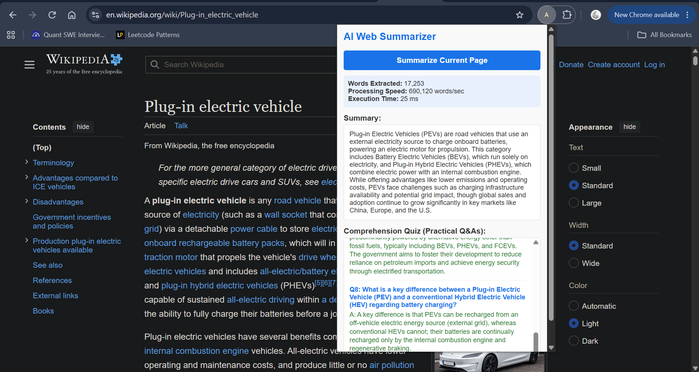

### React documentation

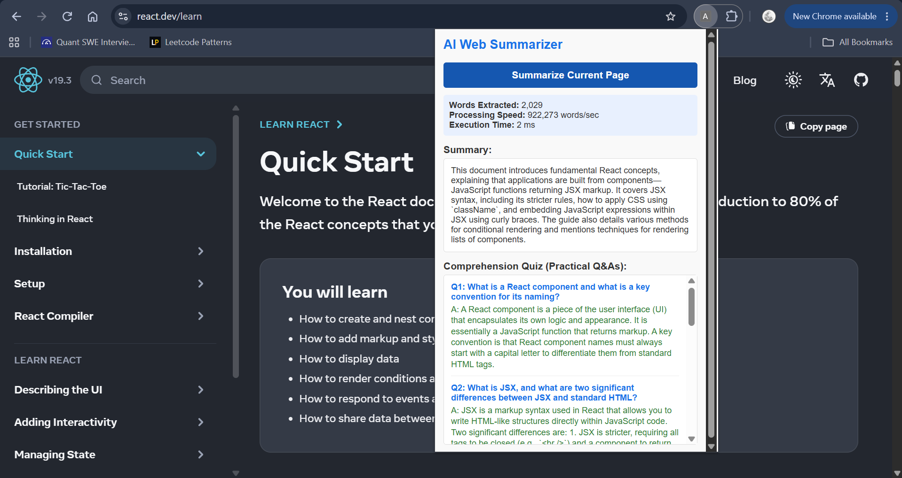

### Another webpage example

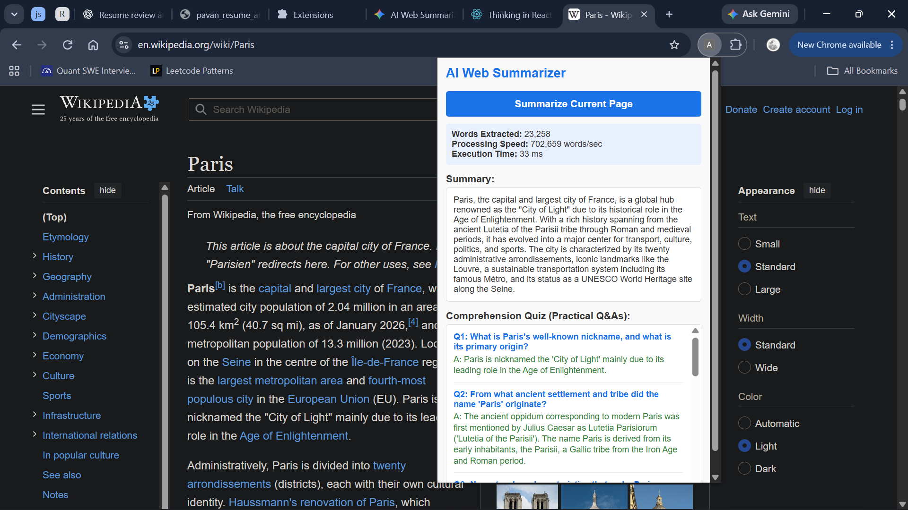

## Features

- **Current-page extraction:** Reads text from the active tab and filters for useful content.
- **AI-generated summaries:** Sends extracted page text to Gemini to create a concise summary.
- **Comprehension Q&A:** Generates practical question-and-answer pairs from the page content.
- **Quiz mode:** Can produce fill-in-the-blank questions for quick review.
- **Parsing metrics:** Displays extracted word count, measured execution time, and derived processing throughput.
- **Graceful empty states:** Shows a clear message when a page does not contain suitable text.
- **Lightweight implementation:** Built with vanilla JavaScript and Chrome Extension APIs, without a frontend framework or build step.

## Screenshots

### Performance metrics on larger pages

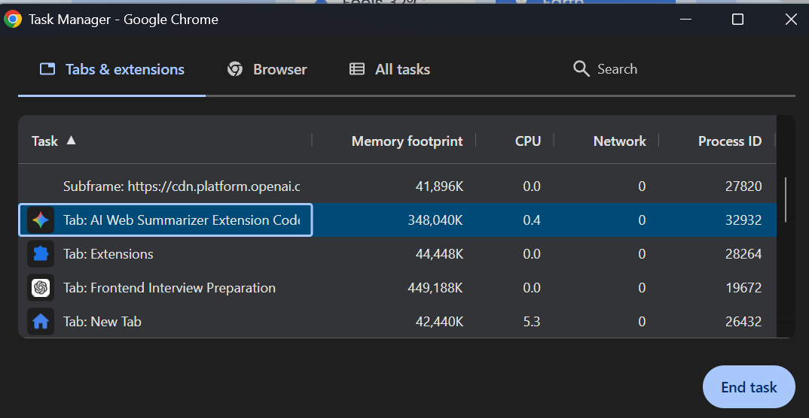

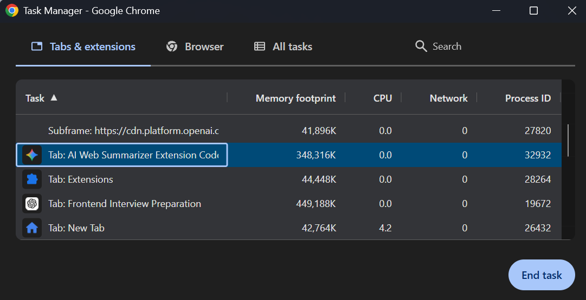

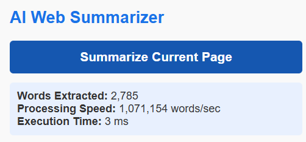

### Summary and quiz examples

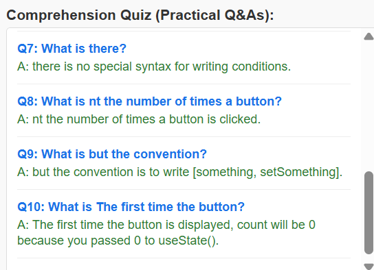

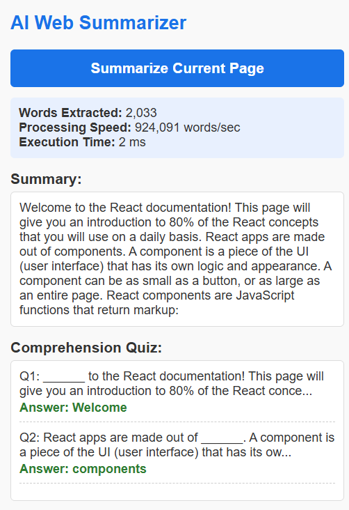

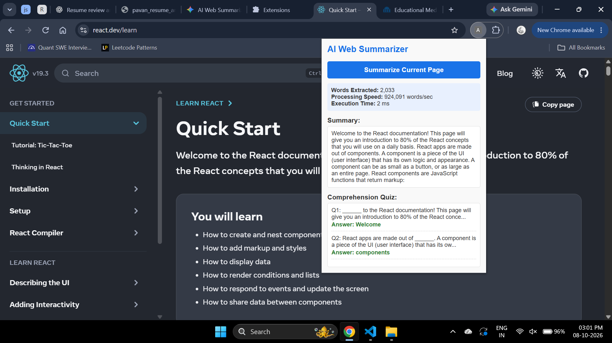

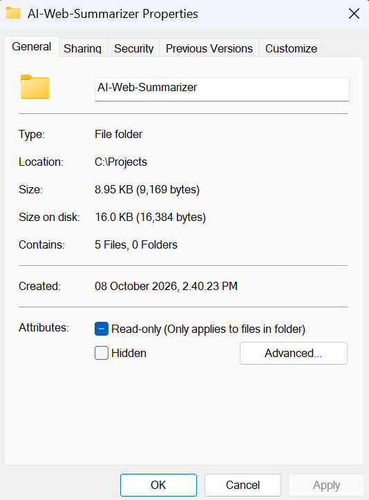

### Edge case: no suitable text

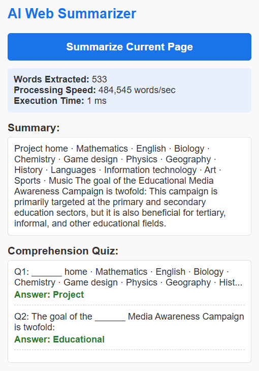

## How it works

1. The user clicks **Summarize Current Page** in the extension popup.
2. The popup script sends a message to the content script in the active tab.
3. The content script extracts visible page text and filters for useful text blocks.
4. It measures extraction time with `performance.now()` and derives throughput from the extracted word count and elapsed time.
5. The extracted content is sent to the Gemini API.
6. The response is parsed and displayed in the popup as a summary and comprehension questions.

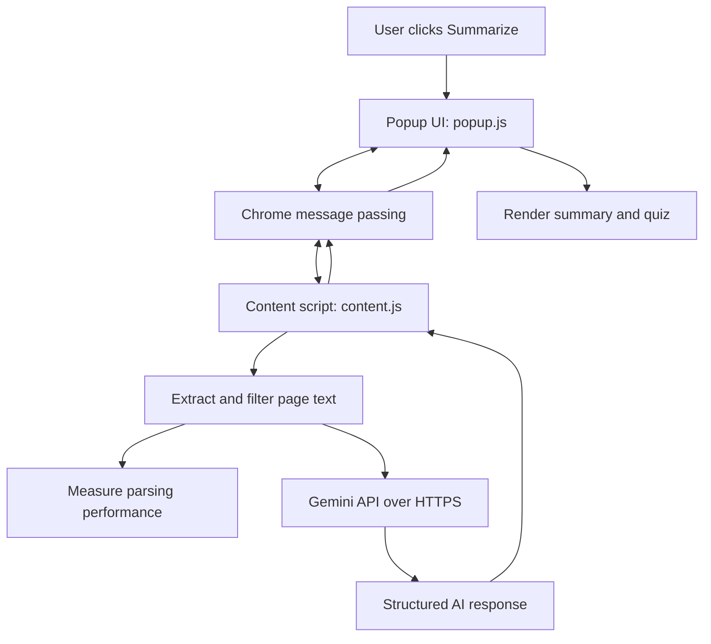

## Tech stack

| Technology | Purpose |
|---|---|
| JavaScript (vanilla) | Extension logic and UI behavior |
| Chrome Extension API (Manifest V3) | Popup, active-tab communication, and content-script integration |
| Gemini API | Summaries and question generation |
| `performance.now()` | High-resolution timing for extraction benchmarks |
| JSON response format | More predictable parsing of AI output |

### Why vanilla JavaScript?

The extension does not need a large UI framework. Vanilla JavaScript keeps the implementation simple and avoids build tooling and framework runtime overhead.

## Performance notes

The popup displays the extracted word count, elapsed extraction time, and calculated throughput. Example measurements visible in the supplied screenshots include:

| Example | Words extracted | Execution time | Displayed throughput |
|---|---:|---:|---:|
| Wikipedia — Plug-in electric vehicle | 17,253 | 25 ms | 690,120 words/sec |
| Paris article | 23,258 | 33 ms | 702,659 words/sec |
| React documentation | 2,029 | 2 ms | 922,273 words/sec |
| Other page sample | 2,785 | 3 ms | 1,071,154 words/sec |

**Interpretation:** These are example measurements from the extension UI, not a universal performance guarantee. The throughput is derived from word count divided by the measured extraction duration, so it varies with page content, device, browser, and timing granularity. The measurements refer to the local extraction/parsing step—not Gemini's end-to-end response time.

The project folder was measured at **8.95 KB (9,169 bytes)** in Windows folder properties for the five-file version captured in the screenshot. That figure describes the original extension folder at that point in time, not the size of this README-and-screenshots package.

## Error handling and edge cases

- Displays an empty state when a page has no suitable text to summarize.
- Handles missing page text without assuming that every page has readable content.
- Network and API failures should be surfaced as user-friendly errors rather than silently failing.

## Security considerations

The Gemini API key must **never be committed to a public repository**. Keeping a key in a local `config.js` file and adding that file to `.gitignore` prevents accidental source-control commits, but it does **not** make the key secret in a distributed browser extension: users can inspect extension files and network requests.

For a publicly distributed version, route Gemini requests through a backend or cloud worker that stores the API key server-side, applies rate limits, and validates request sizes. Before publishing, verify that no API key appears in tracked files, screenshots, commit history, or packaged extension files.

The UI should render page-derived and AI-generated text as text (for example, using `textContent` or `innerText`) rather than injecting untrusted strings with `innerHTML`.

## Run locally

1. Clone or download this repository.
2. Ensure the Gemini API key is configured locally in the configuration expected by the extension. Do not commit the key.
3. Open Chrome and navigate to `chrome://extensions`.
4. Enable **Developer mode**.
5. Select **Load unpacked** and choose the extension's source directory.
6. Open a normal webpage and click the AI Web Summarizer extension.
7. Click **Summarize Current Page** and inspect the generated summary and quiz.

> This repository README documents the project and its screenshots. Ensure the actual extension source files and `manifest.json` are included in the repository for the local installation steps to work.

## Testing

The project was manually exercised on multiple content-heavy pages, including Wikipedia and React documentation. The supplied screenshots demonstrate several page examples and an empty-text state.

If you state that the extension was tested across **100+ webpages**, keep a repeatable test list or script in the repository so that claim can be verified. Likewise, benchmark results are strongest when accompanied by the test device/browser version, repeated-run count, and the exact code path being timed.

## Known limitations

- Some websites use complex layouts, shadow DOM, embedded documents, or dynamically loaded content that may not be represented well by basic text extraction.
- Very large pages need a payload limit to control model token use, latency, and cost.
- Direct API calls from a distributed extension are not suitable for protecting a private API key.
- AI-generated summaries and answers may contain inaccuracies and should be checked against the source page.

## Future improvements

1. **Backend proxy:** Move Gemini calls to a backend or cloud worker to protect the API key and support rate limiting.
2. **Streaming responses:** Stream generated content into the popup to reduce perceived waiting time.
3. **Customization:** Let users select summary length, quiz difficulty, and output language.
4. **Automated benchmarks:** Add a reproducible benchmark script and record browser/device details.
5. **More robust extraction:** Improve handling of single-page applications, repeated navigation text, and article-specific content.

## Ownership

Designed and implemented end-to-end as a solo project, including extension architecture, DOM text extraction, Gemini integration, UI rendering, and performance measurement.

---

**Note:** Replace any repository-specific links or setup details as needed, and confirm all performance and test-count claims against the current source before publishing.
