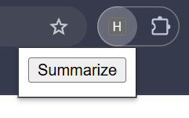
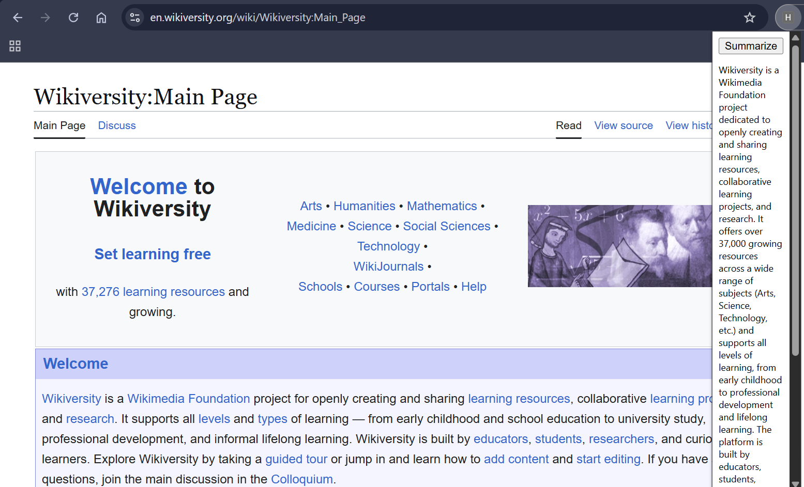
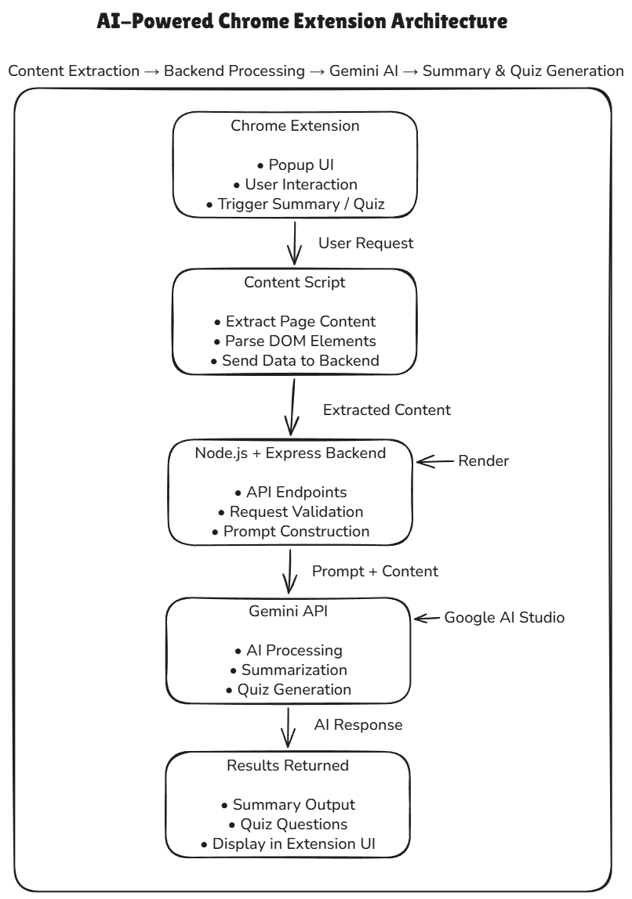

# AI-Powered Web Summarizer Chrome Extension

## Overview

AI-Powered Web Summarizer is a Chrome extension that extracts content from web pages and generates concise summaries using Google's Gemini AI. The extension combines browser-side DOM parsing with a Node.js backend to help users quickly understand long-form articles and web content without reading the entire page.

The project demonstrates the integration of Chrome Extension APIs, content scripts, backend services, and Large Language Models (LLMs) to build a practical productivity tool.

---

## Live Demo

Backend API:
https://ai-web-summarizer-lwuk.onrender.com/

---

## Features

- Extracts webpage content directly from the browser using content scripts.
- Generates concise AI-powered summaries of web articles and pages.
- Processes large webpages efficiently through text preprocessing and content filtering.
- Uses Chrome Extension APIs for seamless browser integration.
- Implements asynchronous communication between the extension and backend server.
- Powered by Google's Gemini AI model for natural language understanding and summarization.

---

## Architecture

```text
Chrome Extension
      │
      ▼
Content Script
      │
      ▼
Node.js + Express Backend
      │
      ▼
Gemini API
      │
      ▼
Generated Summary
```

### Workflow

1. User opens a webpage.
2. User clicks the extension popup.
3. The content script extracts webpage text.
4. Extracted content is sent to the backend API.
5. Backend forwards the request to Gemini AI.
6. AI-generated summary is returned to the extension.
7. Summary is displayed inside the popup.

---

## Screenshots

### Extension Popup



### Generated Summary



### Architecture Diagram



---

## Tech Stack

### Frontend

- JavaScript
- HTML
- CSS
- Chrome Extension APIs

### Backend

- Node.js
- Express.js

### AI

- Google Gemini API

---

## Project Structure

```text
AI-Web-Summarizer/
│
├── extension/
│   ├── manifest.json
│   ├── popup.html
│   ├── popup.js
│   ├── content.js
│   └── styles.css
│
├── backend/
│   ├── server.js
│   ├── package.json
│   └── .env.example
│
├── screenshots/
│
└── README.md
```

---

## Challenges Solved

- Browser-to-backend communication using Chrome Extension APIs.
- Content extraction from arbitrary webpages.
- Handling large webpage content efficiently.
- Integrating external AI APIs for real-time summarization.
- Managing asynchronous messaging between popup, content script, and backend services.

---

## Future Enhancements

- AI-generated quiz creation from webpage content.
- Selected text summarization.
- YouTube video summarization.
- Summary history and bookmarking.
- Improved content extraction using Mozilla Readability.
- Cloud deployment for public access.
- Multi-language support.

---

## Learning Outcomes

Through this project, I gained practical experience with:

- Chrome Extension Development
- DOM Manipulation
- Client-Server Architecture
- REST APIs
- Node.js and Express.js
- AI API Integration
- Asynchronous JavaScript
- Real-world Product Development

---

## Author

Pavan Teja

GitHub: https://github.com/urstrulypavan

LinkedIn: https://linkedin.com/in/pavan-teja-mantri
